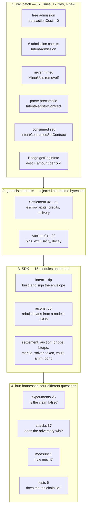

# What is actually implemented

**TL;DR** — a map of the PoC as it exists, with no reference to what any document claims about it. The
whole node-side change is **573 lines across 17 files, four of them new**. Everything else is two
genesis contracts, a TypeScript SDK, and four harnesses. Where the spec and the code disagree, that
belongs in [ADMISSION-RULES.md](ADMISSION-RULES.md) and [CLAIMS.md](CLAIMS.md), not here. This file
answers one question: *what is there?*

## 1. The node patch

Everything the fork changes, from `git diff` against the pr3558 typed-transaction base.

### New files

| File | Lines | What it contains |
|---|---|---|
| `co/rsk/intent/IntentAdmission.java` | 77 | the six pre-inclusion checks, in one static `check()`, short-circuiting in a fixed order |
| `co/rsk/intent/IntentConstants.java` | 105 | subtype `0x49`, the designated addresses, the consumed-set and Bridge-ticket slot derivations, and the `intent.requireBtcTicket` / `intent.maxExpirySpan` system properties |
| `co/rsk/intent/IntentRegistryContract.java` | 61 | the stateless parse precompile: recovers the signer and returns the six decoded fields |
| `co/rsk/intent/IntentConsumedSetContract.java` | 229 | the consumed set at its own address `0x…24`, under a domain-tagged key. `isConsumed` reads, `markConsumed` writes and is restricted to Settlement. Extends `NativeContract` because that is required — see the note below |

### Modified files

| File | Δ | The change |
|---|---|---|
| `core/Transaction.java` | +13 | `isNativeIntent()` = RSK namespace && subtype `0x49`; and `transactionCost()` returns **0** for one, gated on `RSKIPINTENT` |
| `core/bc/TransactionPoolImpl.java` | +14 | activation gate (`native intents are not active yet`), then the call into `IntentAdmission.check` |
| `mine/MinerUtils.java` | +2 | `txs.removeIf(t -> t.isNativeIntent())` — an intent is never put in a block |
| `vm/PrecompiledContracts.java` | +17 | registers the parse precompile at `0x…20` and the consumed set at `0x…24`, both activation-gated |
| `upgrades/ConsensusRule.java` | +1 | `RSKIPINTENT("rskipIntent")` |
| `peg/Bridge.java` | +9 | exposes `getPeginInfo` |
| `peg/BridgeMethods.java` | +12 | declares it: `getPeginInfo(bytes32) -> bytes`, fixed cost 30 000, `RSKIPINTENT`-gated, static-call allowed |
| `peg/BridgeSupport.java` | +18 | at peg-in, records 64 bytes (`destWord ‖ amountWord`) under `intentPeginInfo-<txid>`, and reads them back |
| `peg/constants/BridgeRegTestConstants.java` | ±1 | `minSecondsBetweenCallsReceiveHeader = 0` (was 300) so regtest can relay headers without throttling |
| `resources/config/regtest.conf` | +1 | `rskipIntent = 40` — the regtest activation height |
| `resources/reference.conf`, `expected.conf` | +2 | register the config key |
| `resources/genesis/rsk-dev.json` | +19 | `alloc` entries carrying Settlement and Auction runtime bytecode |

**Five mechanisms, and that is the whole fork:** a transaction type that costs nothing, six checks that
run before the EVM, a miner that drops the type, a precompile that parses it, and a precompile that
owns the consumed set. The Bridge change is a read-only convenience so a contract can learn a peg-in's
destination and amount.

**One constraint that is not written down anywhere else.** A stateful precompile MUST extend `Bridge`,
`RemascContract` or `NativeContract`. `Program.callToPrecompiledAddress` builds
`PrecompiledContractArgs` and calls `init()` only for those three types, so anything else gets no
repository and every call fails as a bare `ok=false` with no message. The consumed set hit this
exactly; the parse precompile is unaffected only because it is stateless.

## 2. The address map

Six numbered addresses are in play and they are easy to confuse.

| Address | What | Where it comes from |
|---|---|---|
| `0x…01000006` | RSK Bridge | pre-existing precompile |
| `0x…01000020` | intent parse precompile | new, registered by the patch |
| `0x…01000021` | **Settlement** | genesis `alloc`, runtime bytecode |
| `0x…01000022` | **Auction** | genesis `alloc`, runtime bytecode |
| `0x…01000023` | `BTC_OUT` sentinel | not a contract — a marker value in `outputToken` |
| `0x…01000024` | **consumed set** | new precompile, registered by the patch |
| `0x0000…0000` | native RBTC | zero address in `outputToken` |

## 3. The genesis contracts

Both are injected as runtime bytecode by `contracts/compile.js`, which also writes
`rskj-patch/genesis/*.runtime.hex` and syncs `sdk/src/abi/*.json`. Neither has a constructor.

**Settlement** (`0x…21`) — `settle`, `settleBtcOut`, `depositForPegin`, `reserveExit`,
`forfeitExpiredExitBond`, `withdraw`, `isConsumed` (a proxy to `0x…24`), `consumedSetProbe`,
`legacyIsConsumed` (deprecated), `bindingOf`. State: `pegin` (escrow per txid),
`peginIntent` (its `keccak256(H‖signer)` binding), `claimedPegin`, `claimedBtcOut` (per payout output),
`exitReservations`, `credit`. Constants: `MIN_BTC_CONF 1`, `RESERVE_WINDOW 30`, `MAX_PAYOUT_OUTPUTS 64`,
`PUSH_GAS 30 000`, settler tag `"RSKX"`. The consumed set is **not here** — it moved to `0x…24` after
attack B6, because `sstore(H, …)` at slot number `H` shared an address space with all six mappings
above and a chosen `H` could write into them. `legacyIsConsumed` still reads that retired namespace so
the regression test can show it stays empty.

**Auction** (`0x…22`) — `bid`, `bidToken`, `execute`, `reclaim`, `withdraw`, `withdrawToken`,
`lockedUntil`. State: `bids`, `failedAt`, `credit`, `creditToken`. Constants: `WINDOW 10`, `GRACE 10`,
`MIN_EXECUTE_GAS 500 000`, `PUSH_GAS 30 000`. Exclusivity decays from `failedAt + GRACE` — a *recorded
execution failure*, not elapsed time.

**Deployed by the SDK, not genesis:** `Vault` (bvBTC shares), `TokenVault`, `Pool` (zero-fee constant
product AMM), `Bond` (0.1 RBTC minimum). **Adversarial helpers:** `BadToken` (fee-on-transfer / liar /
no-return), `PoisonToken` (blocked recipients), `Griefer` (no `receive`), `Reenterer`, `Turncoat`
(toggleable payability), `TestToken`.

## 4. The SDK

15 modules under `src/`. The load-bearing ones:

| Module | What it does |
|---|---|
| `intent.ts` | builds and signs the `0x02‖0x49` envelope; `buildRawIntent` bypasses the 160-byte assert for the board |
| `rlp.ts` | hand-rolled port of rskj's RLP quirks — zero `gasPrice` → raw `0x00`, zero `value` → `0x80` |
| `reconstruct.ts` | rebuilds signed bytes from a node's JSON view and proves them by hashing to the advertised tx hash |
| `client.ts` | minimal JSON-RPC, including `pendingTxs()` over `txpool_content` |
| `settlement.ts` / `auction.ts` / `bond.ts` | typed wrappers over the contracts |
| `bridge.ts` / `btcrpc.ts` / `merkle.ts` | header relay, bitcoind driver, BIP37 proof → RSKIP-122 branch |
| `solver.ts` | the toy solver: classify a pool entry, call `settle` |
| `token.ts` / `vault.ts` / `amm.ts` | test-asset deployment |
| `config.ts` | every address and constant in one place |

## 5. The four harnesses

They answer four different questions, and conflating them is the main way to get lost.

| | Asks | Count | Output | Entry point |
|---|---|---|---|---|
| `experiments/` | is this claim false? | 25 | pass / fail | `npm run all`, or `npm run e7` |
| `attacks/` | does this adversary win? | 37 | blocked / contained / succeeds / untested | `npm run attacks` |
| `measure/` | how much? | 1 | distributions in `measurements/*.jsonl` | `npm run m01` |
| `test/` | does the toolchain itself lie? | 6 | pass / fail, no node needed | `npm run test:all` |

**Attacks by class:** A admission 6 · B entry escrow 5 · C settlement atomicity 7 · D auction 4 ·
E exit 8 · F reorg 3 · M miner 4. **Expected outcomes:** 20 blocked, 6 contained, 6 succeeds,
5 untested. Implementations: 16 native (own forensics harness), 16 wrapped (shell out to an
experiment), 8 untested placeholders.

**Infrastructure the board can demand:** `_stacks.ts` declares two stacks (`default` two-node with
bitcoind and timer mining, `reorg` two-node on-demand without bitcoind); `_fresh.ts` boots a
throwaway node with a mounted genesis so an attack can pick its own activation height, node flags, and
planted storage. `_forensics.ts` provides balance-delta tracking and revert decoding.

## 6. Where the detail lives

- [ADMISSION-RULES.md](ADMISSION-RULES.md) — the eight refusal points, their exact messages, coverage,
  and where the spec disagrees with the code.
- [CLAIMS.md](CLAIMS.md) — every claim and what evidence backs it, including the measured numbers.
- `poc/sdk/attacks/README.md` — the board's own conventions.
- [RSKIP-draft-native-intents.md](RSKIP-draft-native-intents.md) — the specification, which is a
  different thing from this file and should be read as such.
