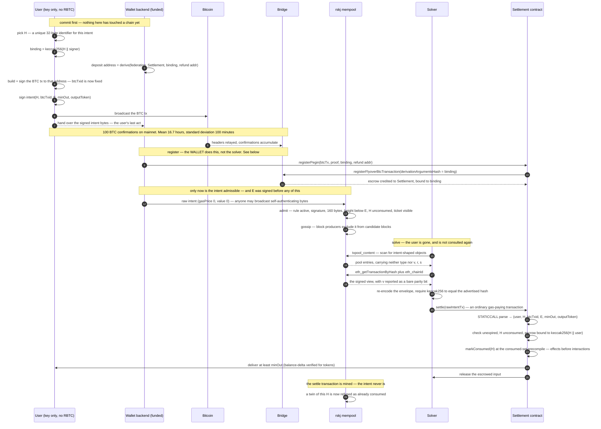
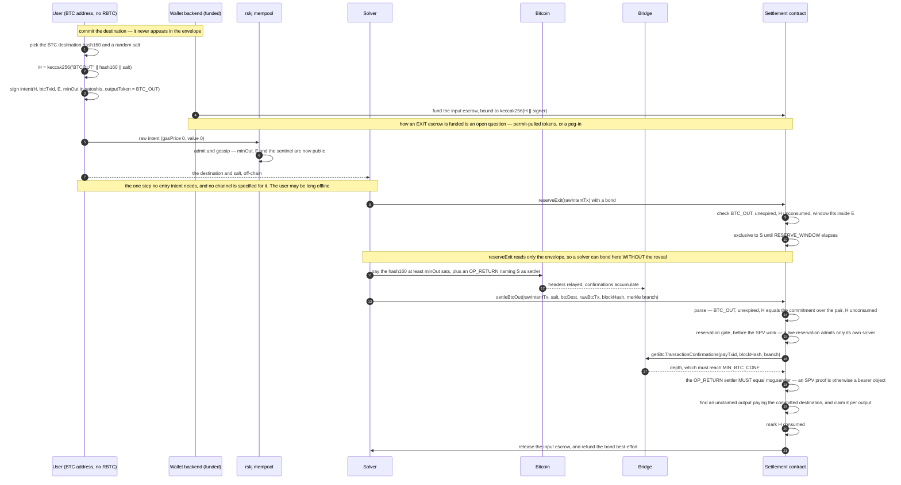

<!--
  CANONICAL SOURCE: the Notion page "RSKIP-XXX — Native intent transactions (draft)".
  https://app.notion.com/p/3cfc132873f98169afa0c6f5b3b4e159

  This file is a synced copy so the repository is self-contained for review. Edit the Notion page;
  regenerate this file from it. The two drifted once — Notion gained a rewritten abstract, two extra
  admission rules and four security items, while this file gained findings from the attack board —
  and reconciling them by hand is exactly the work this note exists to prevent.
-->

|RSKIP|XXX|
| --- | --- |
|**Title**|Native intent transactions|
|**Description**|A mempool-only transaction type in which users sign constraints rather than calldata, and solvers compete to satisfy them for a spread|
|**Created**|2026-09-01|
|**Author**|Juraj Piar (@jurajpiar)|
|**Purpose**|Usability, Interoperability|
|**Layer**|Core|
|**Complexity**|2|
|**Status**|Draft|

# Abstract

This proposal introduces a Rootstock-specific transaction type in the RSK typed-transaction namespace (`0x02 || rsk-tx-type` under RSKIP-543/545/546). Instead of signing exact calldata, the user signs constraints: a unique intent identifier, a minimum output, an output asset, an expiry height, and a Bitcoin-backed anti-spam reference.

The intent is a free, mempool-only object. Nodes validate it before admission and gossip it like a transaction, but block producers never mine it on its own. A solver fulfils the intent through an ordinary gas-paying transaction. In one atomic call, the settlement contract delivers at least the signed minimum to the user, releases the intent-bound input to the solver, and marks the intent as consumed. The difference between input and output is the solver's fee.

The proposal defines the envelope, admission rules, parsing precompile, consumed set, settlement contract, input binding, price competition, Bitcoin exit path, and activation gate.

Together, these pieces support gas-free, Bitcoin-anchored entry and exit flows. A user whose value is arriving from Bitcoin can transact on Rootstock without first holding RBTC or submitting a Rootstock transaction. Two honest caveats attach to that. A funded party — in practice the wallet's own backend — must register the peg-in before the intent becomes admissible, so the flow is gas-free for the *user* rather than for everyone. And any "near-instant" experience still depends on a solver choosing to front value before final settlement.

# Motivation

Many benefits attributed to intents can already be built with smart contracts, even if contracts sometimes deliver them less elegantly. This proposal depends on two narrower properties that contracts cannot provide because they execute only after inclusion.

First, **mempool access for an account that cannot pay**. Admission happens before the EVM runs. A signed message from a new, zero-balance account can therefore become a gossiped mempool object only if the node recognises it specially. A contract cannot make that happen. ERC-4337 addresses the same limitation through a separate, off-protocol mempool.

Second, **invalidity before inclusion**. Contract-level expiry and replay checks consume block space and gas, even when they revert. A node can reject an expired or consumed intent before it reaches a block, leaving no on-chain trace and costing the user nothing.

Constraint checking, signing UX, and output bounds remain important, but they do not independently justify a consensus change. The two pre-inclusion properties above are the load-bearing claims.

Those properties matter only if solvers have a reason to act. The settlement design therefore gives a successful solver the user's intent-bound input and lets it keep the spread. A contract can enforce the atomic exchange once the escrow exists; the native and Bridge-facing work is what makes a payer-less Bitcoin input available to that contract under an authenticated binding.

The main use case is Bitcoin-anchored execution on Rootstock. A solver may front the requested output against a Bitcoin event, then settle trust-minimally once the event is visible to the Bridge.

# Specification

## The full path, end to end

The flow spans two chains and six parties, and the ordering carries most of the design's weight. Two constraints fix it. The deposit address depends on the binding, so the commitment and the signing key are settled before any coins move. And an intent is admissible only once its ticket is a peg-in the Bridge has processed, so **registration precedes broadcast**.



The escrow-binding check inside `settle` is where the binding earns its keep: a rival intent carrying the same `H` under a different key derives a different binding and matches no escrow.

**Discovery is the mempool, and nothing else.** On the entry path the envelope is self-sufficient: `outputToken`, `minOut`, `E` and the escrow reference are everything a solver needs to price and fill, and they travel in the clear. The user's involvement ends at broadcast. This is measured, not assumed — a solver process given only an RPC URL, holding no reference to the user, the intent, or `H`, discovers the intent in the pool, rebuilds its signed bytes and settles it, with the user delivered `minOut` and the escrow released (experiment E24).

Implementers should note what that costs, because the JSON-RPC surface is not shaped for it. `txpool_content` omits both `type` and `v`, `r`, `s`, so a pool listing cannot be re-encoded on its own; discovery is a listing followed by `eth_getTransactionByHash` per candidate. rskj has no `eth_getRawTransactionByHash`, so re-encoding is the only route to the bytes `settle` requires, which makes the encoding rules above load-bearing for solvers and not only for signers. And because `getEncodedV` reports `yParity` for any typed transaction while the RSK-namespace envelope carries an EIP-155 `v` — with `chainId` absent from the view for this namespace — a solver must recombine the parity with `eth_chainId`. A reconstruction is verifiable without trusting any of this: the transaction hash is `keccak256` of the signed bytes, so a solver can require its own re-encoding to hash to the hash the node advertised, and refuse to settle otherwise.

**Who registers the peg-in.** Admission requires the ticket to be visible, so registration precedes gossip. That excludes a solver who learns of intents *from the mempool* — it would have to act on one it cannot yet see. It does not exclude solvers generally: `settle` takes the intent as calldata and never requires it to have been gossiped, so a solver handed the bytes directly can register and settle in one transaction. Registration is permissionless, so any funded party may do it.

This is a real cost, and it should be stated rather than glossed. The user needs no RBTC and signs no Rootstock transaction, but *somebody* funded must send one before the intent becomes discoverable. A wallet without a funded backend cannot complete the flow alone.

Two candidates, and this proposal does not yet choose between them:

- **A funded party acting for the user** — the wallet's own backend, or the dApp being transacted with. Simple, and what the reference implementation does. It costs that party one transaction per intent, and it makes them a liveness dependency: precisely the named counterparty a payer-less design exists to remove. A wallet that is only a key manager, with no funded backend, cannot complete the flow alone.
- **Folded into settlement.** A solver holding the intent bytes registers and settles in one transaction, paying for registration exactly where it captures the spread. No separate role, and no free-riding — registration is otherwise a public good, since it makes the intent settleable for *every* solver while only one is repaid. The cost is that discovery then happens off-chain, which leaves the public mempool doing less work than the Motivation claims for it.

Note what is *not* a way out. Because rejection is free and leaves no trace, a wallet may poll — offer the intent, and re-offer it once registration lands — which removes any need to synchronise with the registrant. That is a convenience, not an answer: retrying does not cause registration to happen, and a loop that spins until `E` looks like progress while the user's bitcoin sits in a derived address and the escrow is never credited.

## Transaction envelope

An intent uses the RSK typed-transaction namespace:

```
0x02 || rsk-tx-type || rlp([nonce, gasPrice, gasLimit, to, value, data, v, r, s])
```

`0x02` is the RSK namespace prefix defined by RSKIP-543. `rsk-tx-type` selects the intent subtype; `0x49` is proposed, with the final value assigned on acceptance.

The body reuses the existing nine-field legacy format, with the signed constraints stored in `data`. No new outer parser or encoder is needed.

For a non-zero chain ID, the signing hash is:

```
keccak256(
  0x02 || rsk-tx-type ||
  rlp([nonce, gasPrice, gasLimit, to, value, data, chainId, "", ""])
)
```

The signature uses EIP-155, with `v = yParity + chainId * 2 + 35`. The chain ID MUST be non-zero.

`to` is the settlement-contract address. Both `gasPrice` and `value` MUST be zero because the intent is a free discovery object rather than a mined transaction.

The sender is recovered from the signature. A wallet SHOULD use a fresh address for each intent so that uniqueness follows the payload commitment rather than an account nonce.

**Encoding requirement.** rskj serialises a zero `gasPrice` as the raw byte `0x00`. A zero `value` and zero `nonce` use the RLP empty scalar `0x80`. A signer MUST reproduce this encoding exactly; otherwise it calculates a different signing hash and the node recovers the wrong sender.

## Signed constraints

`data` is exactly 160 bytes: five 32-byte words.

```
data = H (32) || btcTxid (32) || expiryHeight E (32) || minOut (32) || outputToken (32)
```

- `H` is a 32-byte value chosen by the user, unique per intent. It keys the consumed set, and on the entry path that is the only role settlement gives it: `settle` verifies delivery of `minOut` in `outputToken` and the escrow binding, and never opens `H`. Calling it a "pipeline commitment" describes a convention a wallet may adopt — `H = keccak256(pipeline)` lets the user prove afterwards what they asked for — not a value any consensus or contract rule inspects. An opaque `H` is exactly as settleable as a structured one.
- `btcTxid` identifies the confirmed Bitcoin transaction used as the anti-spam ticket and input-escrow reference.
- `E` is the absolute Rootstock block height at which the intent expires.
- `minOut` is the minimum output accepted by the user and enforced during settlement.
- `outputToken` selects the output asset. The zero address means native RBTC. An ERC-20 address selects a token, including vault shares or LP tokens. A reserved sentinel denotes BTC delivered on Bitcoin.

For a Bitcoin exit, `minOut` is denominated in satoshis. `H` also commits to the user's Bitcoin destination:

```
H = keccak256("BTCOUT" || hash160 || salt)
```

The settlement contract verifies that commitment without adding another field to the envelope.

**The exit is where a reveal is genuinely required, and it is the only place.** `settleBtcOut` re-derives the hash above from a `hash160` and `salt` the settling solver passes as arguments, so it does open the preimage. Neither value is in the 160 bytes. An exit intent is therefore discoverable from the mempool but not fillable from it: the solver needs a channel carrying the destination and salt, and this proposal does not specify one. Entry intents have no such dependency — everything a solver needs is in the envelope, in the clear. The salt buys destination privacy and pays for it in liveness, and the proposal should say which it is choosing rather than acquiring both by omission.

## Mempool admission

A node admits and gossips an intent only when all of the following are true:

1. the intent rule is active;
2. the signature is valid and the chain ID matches;
3. the payload uses the exact 160-byte layout;
4. the current best height is below `E`, and `E` is no further ahead than the configured maximum;
5. `H` is not already in the consumed set; and
6. `btcTxid` is visible as a processed peg-in in the Bridge's SPV-backed state.

An active intent has zero transaction cost. The usual balance and account-existence checks therefore do not reject a payer-less sender. Expired, consumed, malformed, or ticketless intents are rejected before entering the mempool and never consume block space or gas.

Block producers remove intent objects from their candidate transaction list. The intent itself never appears in a block; settlement arrives as an ordinary solver transaction. This leaves the existing proof-of-work and merged-mining mechanisms unchanged, although activating the parser and system contracts still requires a coordinated network upgrade.

## Parser and consumed set

Three fixed, protocol-designated addresses divide the work.

- **Parsing precompile:** a stateless precompile accepts the raw signed intent, reconstructs the RSK-namespace signing hash, recovers the user, and returns `(user, H, btcTxid, E, minOut, outputToken)`. This is the one part that is impractical to reproduce safely in Solidity. Any contract may call it with `STATICCALL`.
- **Consumed-set precompile:** a stateful precompile owning the consumed set at its own address. `isConsumed(bytes32 H)` returns zero when `H` is unconsumed and otherwise the height at which it was marked; `markConsumed(bytes32 H)` records it and MUST be callable only by the settlement contract, never under `STATICCALL`, and MUST refuse a second mark. The storage key MUST be domain-separated — a derivation of `H`, not `H` itself. Mempool admission reads this address with the same derivation.
- **Settlement contract:** a contract deployed at activation that parses, delivers the output, releases the input, and calls `markConsumed`. It does not own the consumed set.

**Why the consumed set is not contract storage.** An earlier version of this proposal placed it in the settlement contract at `slot == H`. That is unsafe, and the reason generalises beyond any one implementation: Solidity places `someMapping[k]` at `keccak256(abi.encode(k, declarationIndex))`, a public formula over public inputs, while `H` is thirty-two bytes the user chooses freely and no rule constrains its provenance. An attacker can therefore compute the storage address of a chosen mapping entry, sign an intent whose `H` is that address, and have settlement write into a variable the contract believes only it can reach. Measured on a node (attack B6): a boolean guarding a peg-in claim was set with no peg-in ever claimed, and poisoning the escrow-binding entry for a not-yet-registered `btcTxid` made that escrow permanently unfundable, because the deposit path refuses any binding that does not match what is already stored. The attacker learns the victim's `btcTxid` from Bitcoin, roughly a hundred confirmations before registration can occur, so the exposure window is the peg-in wait itself.

Two properties follow, and both are requirements rather than implementation advice. The set MUST occupy a namespace nothing else shares — a distinct address, and a domain-separated key within it. And the derivation MUST be identical in the node's admission path and in the precompile: a divergence would leave admission reading a permanently empty slot and silently ceasing to reject consumed intents.

This also answers where the state belongs. The consumed set plays the same role for intents that account nonces play for ordinary transactions, and nonces are node state. Placing it in a precompile does not enlarge the consensus surface either, because mempool admission reads it: under the contract-storage design every node already had to agree on the settlement bytecode, so consensus-critical state was merely wearing a contract's clothes. Ordinary storage proofs still prove membership, at the derived key.

The consumed marker commits only when the entire settlement succeeds. If settlement reverts, the marker and every transfer revert together — for a precompile this requires that a failed call roll back its own writes and surface as a failed call to the caller, which the reference implementation obtains from the post-RSKIP-197 precompile error path. A chain reorganisation behaves in the same way: removing the settlement block removes both delivery and consumption, allowing the intent to be solved again if it has not expired.

**The derivation is fixed at activation and cannot be revised.** Markers written under one derivation are invisible under another, so changing it would make every previously consumed `H` replayable. It must be settled before the first settlement occurs.

**Implementation note.** In rskj, a stateful precompile must extend `Bridge`, `RemascContract` or `NativeContract`: `Program.callToPrecompiledAddress` builds `PrecompiledContractArgs` and calls `init()` only for those three types, so any other base class receives no repository and every call fails as an unexplained `ok=false`. The stateless parsing precompile is unaffected because it needs no state. `NativeContract` also supplies ABI coding, but it does not expose the calling frame, so the caller check above requires capturing `ProgramInvoke` during `init` and reading `getOwnerAddress()`.

## Value flow

Let `I` be the pegged-in input, `out` the output delivered, and `g` the solver's gas cost. After successful settlement:

- the user gives up `I` and receives `out ≥ minOut`;
- the solver receives `I`, supplies `out`, and pays `g`; and
- the solver earns `value(I) − value(out) − g`.

A solver participates only when it expects the result to be positive. The user sets the maximum implicit fee through `minOut`: they accept an output below the input's market value by enough to cover execution cost, risk, and margin. The difference is the spread.

The spread is paid in kind rather than through a separate fee balance. The protocol does not mint or burn value, and it does not calculate the spread.

## Binding the Bitcoin input

The input must be identifiable from the intent and claimable only through successful settlement.

Native RBTC cannot be pulled from a user's balance without a transaction from that account. The peg-in must therefore credit the settlement contract as escrow. Settlement releases that escrow to the solver only in the same transaction that delivers the signed output to the user.

The escrow must be bound to the specific intent, not just to `btcTxid`. A transaction-ID-only mapping would let an attacker observe the peg-in, create a rival intent with a dust `minOut`, and try to claim the funds first.

Binding to `H` alone is not sufficient either, and the distinction is easy to miss. `H` is a commitment to the *pipeline*, not an authenticator: it travels in the clear in every intent in the public mempool, and settlement never needs its preimage, because settlement is outcome-based. An attacker can therefore copy a victim's `H` and `btcTxid` into an intent of their own, signed with their own key, asking for a dust `minOut`. Every admission rule passes. Settlement recovers the user from the *signature* — so the attacker is the user — and an escrow keyed on `H` matches. The dust goes to the attacker, the entire input goes to the solver, and `H` is consumed, leaving the victim's own intent permanently unsettleable. The dust twin is also the more profitable of the two to any solver, and the solver may simply be the attacker, so this needs neither a race nor an accomplice.

The binding MUST therefore commit to the signer as well as the commitment:

```
binding = keccak256(H || signer)
```

A rival with a different key derives a different binding and commands no funds.

This proposal uses **RSKIP-176 Programmable Peg-in Addresses** to carry that binding. Note the ordering: the deposit address depends on the binding, so `H` and the signing key must both be fixed *before* any coins move, and `btcTxid` is known from the signed Bitcoin transaction before it is broadcast.

1. the wallet fixes `H` and the signing key, and computes `binding = keccak256(H || signer)`;
2. it derives a deposit address from the federation, settlement contract, `binding`, and the user's refund address;
3. it builds and signs the Bitcoin transaction paying that address, which fixes `btcTxid`;
4. the user signs the intent over `(H, btcTxid, E, minOut, outputToken)` and broadcasts the Bitcoin transaction; and
5. the settlement contract registers the peg-in as its own liquidity-bridge contract, with `binding` in `derivationArgumentsHash`.

RSKIP-176's other derivation inputs — the refund address, the liquidity-bridge contract, the liquidity provider — do not include the Rootstock signer, so passing `H` as the derivation argument would reproduce exactly the weakness above at the Bitcoin layer. The derivation argument must be the pair.

The Bitcoin destination itself carries the binding, so it cannot be omitted or stripped by a sender. The design uses the Flyover registration path already deployed in production and is intended to require no Bridge change; that assumption still needs implementation-level confirmation for this exact use.

An ordinary RSKIP-170 `OP_RETURN` peg-in routed to the settlement contract was considered and rejected. It would need a new per-transaction Bridge record but still could not carry `H` without changing the v1 payload format or exceeding Bitcoin's standard data-carrier assumptions. At best, it could provide owner-level rather than intent-level binding.

## Atomic settlement

A solver fulfils an intent by calling `settle(rawIntentTx)`. The contract must ensure that all of the following happen together or not at all:

1. authenticate and parse the intent;
2. confirm that it is unexpired and that `H` is unconsumed;
3. verify that the escrow exists and is bound to `keccak256(H || user)`, where `user` is the address recovered from the signature;
4. protect against re-entrant settlement by marking `H` on the current reversible execution track;
5. deliver at least `minOut` of native RBTC or an ERC-20 from the solver to the user; and
6. release the complete escrowed input to the solver.

For a token output, delivery MUST be verified by the user's **balance delta** across the transfer rather than by the transfer's return value. A fee-on-transfer token moves less than it reports, and a non-conforming token may report success having moved nothing; a return-value check would then let settlement consume `H` and release the input while the user received less than the minimum they signed. An implementation SHOULD also accept an empty return from the transfer, since tokens predating the finalised ERC-20 return no data and would otherwise be unusable as outputs — the delta check is what makes accepting silence safe, because an address that is not a token also returns nothing and moves nothing, and so fails on the delta. The same rule applies wherever the settlement layer escrows an output asset: an auction pulling a token bid must verify the amount that arrived, or it records a bid larger than it holds.

Any failure—including under-delivery, expiry, previous consumption, or a mismatched escrow—reverts the whole call. The user either receives the requested output and the solver receives the input, or neither happens. A failed solver loses gas, while the intent remains available until `E`.

Settlement runs in the VM so normal failure receipts and rollback semantics apply. A raw stateful precompile is deliberately avoided because, in the current executor, a precompile exception does not propagate to the receipt. Bridge and Remasc are written around the same behaviour.

No block-construction change is required. The solver transaction carries the signed intent bytes and EVM atomicity provides the bundle semantics. A block-producer-assembled intent-and-solution bundle remains possible future work for ordering, MEV control, or batching.

Payments to solvers, bidders, and reservers MUST NOT rely solely on reverting pushes. If a recipient cannot accept native currency, the amount becomes a credit that its owner can withdraw later. A broken payee must not be able to undo a valid user delivery, block an auction, or strand an intent.

Such a push SHOULD carry a bounded gas stipend rather than forwarding the remaining gas. This bounds what a hostile payee can spend of the settler's gas, and — because a useful stipend is far below the cost of a single storage write — it also means a contract payee cannot execute any logic while a settlement is still on the stack, removing the settlement-path re-entrancy surface entirely. The withdrawal path cannot be capped, since it must deliver in full; there the ordering rule (record consumption before any external call) is what makes a re-entrant settlement meet an already-consumed commitment.

Payment to the user remains a hard requirement. If the user cannot receive the signed output, settlement must fail.

## Price discovery and the above-`minOut` auction

Under the base rule, `minOut` is the worst rate the user will accept. Any solver able to meet it may settle, and the first valid transaction included wins. Later attempts for the same `H` revert, so a losing solver risks only gas.

An auction can return more of the available spread to the user. Bids are denominated in the intent's output asset: native RBTC is escrowed by value, while ERC-20 outputs are escrowed through `transferFrom`. For a compound intent, a better route produces more of the terminal asset and supports a higher bid; the auction does not need to understand the route itself.

Two designs expose a genuine governance trade-off.

- **Off-consensus auction:** anyone can deploy and use the auction, but a solver may bypass it by settling directly at `minOut`. A bidder left behind by that bypass must be able to reclaim its escrow.
- **Enforced auction:** `settle` checks a designated auction contract. Once a valid bid opens an auction for `H`, only the auction may settle until exclusivity expires. The lock starts only after a bid above `minOut` has been escrowed, so the user always receives more than the signed floor. Permissionless `execute()` remains protected after bidding closes. Exclusivity must also be releasable, so that a settlement which reverts forever inside the auction cannot hold an intent hostage — but that release MUST key on an execution that was **observed to fail**, not on elapsed time. Releasing purely because a grace period has passed hands the intent to whoever withholds the auction's execution: wait out the period, then settle at the floor around a higher standing bid. Worse, for a native-currency output the elapsed-time form has no legitimate trigger at all, since an auction holding the winning bid cannot fail to fund the settlement it wraps. The execution attempt therefore catches the failure, records it, and returns rather than reverting — a revert would roll back the very record the release reads — and it MUST require a gas floor comfortably above a settlement's cost before making the call, or EIP-150's 63/64 forwarding rule would let anyone under-gas the attempt so the inner settlement dies while the recording still runs, releasing a healthy auction on demand. All payouts follow the credit-fallback rule.

This proposal surfaces the choice rather than deciding it. Enforcement prevents bypass, but it also makes the auction part of the settlement rules rather than optional market infrastructure.

## Bitcoin exit path

A Bitcoin exit uses the `outputToken` sentinel and commits the destination in `H`. The solver pays the user's Bitcoin address from its own UTXOs, proves that payment on Rootstock, and claims the intent's escrow through `settleBtcOut`.

The exit inverts the entry's trust shape. On entry the irreversible leg happens first, on Bitcoin, and Rootstock settles against a fact already true. On exit the solver spends irreversibly *after* taking exclusivity and *before* being repaid, so every gate below exists to make that ordering survivable.



Two asymmetries are worth reading off the diagram. The reveal arrow is the only step an entry intent does not have, and `reserveExit` parses nothing but the envelope — so a solver can post a bond on an exit it has not yet been given the means to settle, which is what makes withholding the reveal a griefing lever rather than merely an inconvenience. And the bond refund is deliberately best-effort: a reserver that cannot receive RBTC must not be able to brick its own settlement *after* having spent irreversible bitcoin.

The proof contains:

- SPV inclusion against the Bridge's header chain, using RSKIP-122 `getBtcTransactionConfirmations`; and
- an on-chain parse of the raw Bitcoin transaction showing an unclaimed output of at least `minOut` satoshis to the committed destination.

Claims are tracked per output, not per transaction. One Bitcoin transaction may therefore pay several users and settle several intents, sharing its Bitcoin fee across the batch, up to a bounded maximum output count — the parse is paid for by the settler, so an unbounded scan would let a wide payout exceed any gas limit and become unsettleable.

The payout MUST also carry a **settler commitment**: an `OP_RETURN` output holding a fixed tag and the RSK address entitled to settle with it, which `settleBtcOut` requires the caller to match. Without it the SPV proof is a bearer object — public bytes naming the user's address — and anyone could present another solver's payout against their own dust-`minOut` intent on the same destination. The per-output claim would then consume the payment, and the paying solver's bitcoin would be lost irreversibly. A reservation cannot close this: it keys on `H`, and the hijacker brings a different `H`. Committing the *settler* rather than the intent keeps batching intact, since one output then protects every payment in the transaction. This payload binding is legitimate here for precisely the reason it is not on the entry side — the solver builds this transaction and wants to be repaid, so omitting the commitment costs only the omitter — and it is mandatory, because an optional commitment would simply be harvested whenever it was omitted.

### Bonded exit reservations

The entry-style first-valid race does not work for exits. A Bitcoin payment is irreversible: if two solvers pay the same user, both payments succeed, but only one solver can claim the Rootstock escrow. Rational solvers will not compete on those terms.

`reserveExit` moves the race to Rootstock. Before paying Bitcoin, a solver posts a bond and receives exclusive settlement rights for a window long enough to pay, confirm, and prove the transaction. The reservation is rejected unless that window fits inside the remaining intent lifetime.

Squatting is costly. If a reservation lapses, its bond is added to the input escrow, making the intent more profitable for the next solver. If it survives beyond intent expiry, the bond goes to the user. An unreserved exit may still follow the first-valid rule, although a rational solver is expected to reserve.

The required Bitcoin confirmation depth protects the user. If a payment is reorganised away after settlement, `H` remains consumed and the user loses the payout. Production must use a materially stronger confirmation requirement than the test environment and back the remaining risk with the reservation bond.

Expiry, confirmation depth, and reservation duration must be sized together. The intent needs enough lifetime for payment, confirmations, and proof submission.

## Failure and recovery

If no solver settles an entry before `E`, the funds are not automatically available in the user's account: the peg-in credited the settlement contract. After expiry, the contract must provide an authenticated recovery path to the user's refund address. The same requirement applies to an exit intent's escrow. Flyover's `refundUserPegOut` is the relevant model.

Some of the refund machinery already exists. Since RSKIP-379, introduced with Arrowhead 6.0.0 at mainnet block 6,223,700 and testnet block 4,927,100, peg-in processing follows REGISTER, REFUND, and NO_REFUND outcomes. A rejected peg-in with a recoverable sender is automatically returned to its RSKIP-170 refund address.

The RSKIP-176 derivation includes the user's refund address, so the rejected-peg-in case inherits that existing behaviour. The remaining gap is different: escrow that was credited successfully but remains unused after the intent expires. That expired-intent recovery path needs a new, explicit specification.

## Expiry, replay, and reorganisation

`E` is an absolute Rootstock height and must fall within a bounded horizon from the current block. After a reorg, the intent is evaluated against the replacement branch and is either still valid or expired. A removed settlement also removes its delivery and consumed marker.

### Choosing `E` across the peg-in wait

The user does not have to be online when the intent is broadcast — the bytes are self-authenticating and the wallet backend, which is registering the peg-in anyway, can hold and offer them. But `E` is inside the signed payload, so it is fixed *before the Bitcoin transaction is broadcast*, and admission does not test it until registration completes. The gap is not small and it is not fixed.

Mainnet peg-in requires 100 Bitcoin confirmations (`btc2RskMinimumAcceptableConfirmations`). Confirmation intervals are near-exponential, so the wait is Gamma-distributed: mean 16.7 hours, standard deviation 100 minutes. At a 30-second Rootstock block that is roughly 2000 blocks ahead, give or take 200. Admission then requires both `h < E` and `E − h ≤ maxExpirySpan`, and the reference value of `maxExpirySpan` is 100 blocks — a fifty-minute target the user must hit by forecasting a Poisson process from a day earlier. A fixed `E` lands inside it about one time in five.

The two failure modes are not symmetric, which decides the shape of the answer:

- **`E` too far ahead** is recoverable. Rejection is free and leaves no trace, so the wallet waits and re-offers once `E − h` falls inside the span.
- **`E` already passed** is not. The intent is dead, the escrow is credited, and the user is left to the expired-escrow recovery path that this proposal still owes a specification.

So a rational wallet sets `E` late. The cost is that the intent then becomes admissible only at `E − maxExpirySpan`, which can be many hours *after* the escrow was credited — the user's value sits idle and exposed, waiting for a horizon rule rather than for anything real. Testnet hides this entirely: 10 confirmations put the mean at 1.7 hours with a 32-minute deviation, comfortably inside the same span.

Three levers exist and this proposal does not yet pull one. `maxExpirySpan` can be sized to cover peg-in latency and its variance, at the cost of a bounded horizon that no longer bounds much. Admission can be relaxed so an intent enters the pool before its ticket is visible, which removes the forecast entirely but weakens the spam filter. Or the escrow-keyed admission rule proposed under the anti-spam ticket can be adopted — noting that it pushes the *wrong* way here, since requiring the escrow to exist can only make admission later, never earlier. These are one decision, not three, and it should be taken together with the open question below.

The interaction with fork-aware consensus under RSKIP-555 remains open and must be resolved before the validity rules are finalised.

## Bitcoin-backed anti-spam ticket

v1 requires `btcTxid` to identify a processed Bitcoin peg-in visible in the Bridge's SPV-backed state, which puts a Bitcoin transaction's cost behind free mempool admission and keeps the first version focused on Bitcoin entry and exit.

**As specified, that cost binds entry rather than volume, and the difference is not small.** The rule as written asks only whether the referenced txid *is* a processed peg-in. Nothing binds it to the signer, counts how many intents name it, or dedups. One peg-in therefore admits unlimited intents: fresh `H` each time, since nothing checks its provenance, and a fresh key each time, which sidesteps any per-account pool limit. Measured on a node with the rule enabled, forty-one intents were admitted against a single planted ticket. The ticket is an entry fee per attacker, not a cost per message.

The fix is to check the **escrow**, not the ticket: admit an intent only when an escrow bound to `keccak256(H ‖ signer)` exists for its `btcTxid`. Every field needed is already to hand at admission — `H` and `btcTxid` from the payload, the signer from the signature — so it stays one storage read plus one hash. Each intent then requires its own derived deposit, making the flood cost one Bitcoin transaction *per intent*, which is the design's own premise. It also settles the admission-latency question below, because what is checked becomes escrow existence rather than confirmation depth.

One implementation hazard belongs with that change rather than after it. The consumed set already occupies `slot == H` in the settlement contract, and `H` is attacker-chosen; an escrow marker placed at `slot == keccak256(H ‖ signer)` would share that space, so an attacker could choose an `H` colliding with another intent's escrow slot. The escrow marker must therefore be domain-separated from the consumed set rather than sharing its namespace.

If no solver acts, the recovery mechanism above provides the slow path. General-purpose ticketless intents are outside v1.

## Bonding and endorsement

A competitive solver set cannot be assumed merely because entry is open. Solvers may therefore post slashable bonds and receive endorsements, providing capital-at-risk and reputation signals.

Bonding stays outside consensus in v1. Turning it into a validity gate would recreate a permissioned liquidity-provider set. The solver protocol should instead be published alongside the RSKIP so a new participant has an open path to discovery, pricing, settlement, and — for exits only — the destination reveal.

Flyover's liquidity bridge contract, where LPs post collateral and quotes carry penalty fees, provides a production precedent for sizing. This section states the market assumptions on which liveness depends; it does not make them consensus rules.

## Activation

The proposal uses a dedicated consensus rule. Before the activation height, the zero-cost path, admission checks, parsing precompile, and designated contracts are inert. At activation, the parser becomes available and the settlement and auction contracts are installed through the fork transition.

The activation height remains TBD. RSKIP-543/545/546 must already be active.

# Implementation

A reference implementation exists as a set of patches on top of the rskj typed-transaction branch (PR #3558, which implements RSKIP-545/546 and contains none of this proposal). It includes:

- intent subtype recognition and canonical signing;
- activation-gated, zero-cost admission and block-producer exclusion;
- the stateless parsing precompile, and the consumed set as a stateful precompile at its own address under a domain-separated key;
- intent-bound input escrow using a real peg-in path;
- atomic RBTC and ERC-20 settlement with visible reverts;
- both forms of the above-`minOut` auction, including credit fallbacks and failure-triggered release of exclusivity;
- solver bonding;
- Bitcoin exits with SPV-verified payments, per-output claims, and bonded reservations; and
- a TypeScript SDK and falsification-oriented test suite.

The suite has been run against patched regtest nodes and a real bitcoind. It covers payer-less admission and gossip, free expiry rejection, replay protection, atomic settlement, single-node and two-node reorganisation, token output, visible failure, activation, peg-in binding, rival-intent escrow capture, competing solvers, exit-path negative cases, and mempool-sourced settlement by a solver holding only an RPC URL.

Passing these tests shows that the implementation behaves as expected in that environment. It does not by itself establish production safety or choose sound mainnet economic parameters.

# Rationale

**Separate signing, broadcasting, and paying.** The user signs the constraints, anyone may broadcast the self-authenticating bytes, and the solver pays only when settling. A broadcaster cannot alter or forge the intent and can do little beyond delaying it; someone else can rebroadcast.

**Let the solver claim the input.** A separate fee needs separate funding, but the user may have no Rootstock balance. Paying through the spread makes the exchange self-funding. A fixed protocol fee would also misprice risks that vary by asset, amount, volatility, capital cost, and confirmation depth.

**Charge gas to the solver.** The solver is the party seeking profit and is best placed to simulate execution and price failure. This keeps the user gas-free.

**Describe "instant" honestly.** Trust-minimised settlement can release the input only after the peg-in is registered. A solver may deliver earlier, but then it accepts Bitcoin double-spend, reorganisation, and capital-time risk. The spread can price that risk; the protocol cannot remove it.

**State the liveness dependency.** The public mempool provides common discovery and admission, not guaranteed execution. On the entry path a solver needs nothing but the pool and a visible positive spread. On the exit path it additionally needs the destination and salt committed in `H`, which the envelope does not carry — and there the reveal policy can quietly turn one dApp into the only liveness provider.

**Do not promise competition.** Open entry does not guarantee a competitive market. The defensible claim is that entry is permissionless from activation, while profitable participation may require capital and reputation — and, on the exit path, access to a reveal.

# Backwards compatibility

This proposal requires a hard fork and every full node must update. The subtype is additive and depends on the RSKIP-543/545/546 namespace plus its own activation rule. Existing transaction types remain unchanged.

Because intent objects never appear in blocks, SPV clients do not need to understand their envelope. They will continue to observe ordinary settlement transactions and resulting state changes.

# Test cases

The reference suite treats each experiment as an attempt to disprove one claim. Every case defines the claim, procedure, and observation that would make it false.

The suite should continue to distinguish protocol properties from implementation and market properties. A passing auction or solver test does not make competition a consensus guarantee.

# Security considerations

- **Bitcoin input double-spend:** settlement may claim the input only after the Bridge accepts the peg-in under its confirmation rules.
- **Rival-intent escrow capture:** escrow is bound to `keccak256(H || signer)` through the derived deposit address. An intent that merely copies `btcTxid` controls no funds, and neither does one that copies `H` as well — the signer cannot be forged, because settlement recovers it from the signature. Binding to `H` alone would be insufficient precisely because `H` is public and identifies the intent rather than the party entitled to the input.
- **Consumption griefing:** an attacker cannot consume `H` without completing every required transfer. A failed attempt costs gas and leaves the intent available.
- **Consumed-set aliasing:** `H` is attacker-chosen, so a consumed set keyed on a raw `H` inside a contract's own storage lets a crafted intent write into that contract's other variables — measured, not hypothetical (see *Parser and consumed set*). The set therefore requires its own address and a domain-separated key. The write is confined to entries that are currently zero, and its value is a block height, so the exposure is in booleans and bindings rather than in amounts — which does not make it small: one poisoned escrow binding strands that input permanently. Marking must also be restricted to the settlement contract, since an open `markConsumed` would let anyone kill a stranger's intent for the price of gas.
- **Unpayable participants:** solver, bidder, and reserver payouts use credit fallbacks so a recipient cannot block unrelated progress, and each push carries a bounded gas stipend rather than forwarding the remaining gas.
- **Hostile output tokens:** the output asset is named in the user's own signed intent, so no third party can choose it, and the balance-delta rule bounds what a misbehaving token can do *during* settlement. It cannot bound what the token's issuer does afterwards — an issuer able to freeze or claw back balances defeats any on-chain check — so wallets composing intents on a user's behalf SHOULD restrict output assets to a vetted set rather than accepting an arbitrary address.
- **Auction liveness:** enforced exclusivity must release a wedged intent back to open settlement — but on a *demonstrated* execution failure rather than on elapsed time, or the release becomes a lever for whoever withholds the execution.
- **Exit races:** a bonded reservation moves the irreversible race away from Bitcoin and onto Rootstock. Lapse and expiry must forfeit the bond as specified.
- **Payout hijack:** an SPV proof is a bearer object, so entitlement must travel with the payment rather than with the proof. The settler commitment binds each payout to the party that made it, and an uncommitted payout is unclaimable by anyone. Reservations alone are insufficient — they protect the intent, not the payment.
- **Unbounded payout parsing:** the output scan is paid for by the settler, so the output count is capped. An over-wide payout is refused by name rather than exhausting the caller's gas, and the safe batch size is a stated constant rather than an implicit gas ceiling.
- **Bitcoin payout reorganisation:** confirmation depth and bond size must cover the user's residual risk if a proved payment later disappears.
- **Fronting risk:** before Bridge registration, the solver bears Bitcoin and capital-time risk. The post-registration path settles atomically.
- **Block-producer front-running:** a settle transaction carries the whole authenticated intent in its calldata, so any observer — a block producer most cheaply of all — can settle the same intent first. The user is unaffected (`minOut` still binds), but the honest solver forfeits its gas and any output it pre-acquired, which taxes exactly the participants the design needs. The mitigation already in the design is the auction lock: once an intent is bid upon, a front-run must be expressed as a higher bid, which pays the surplus to the user. Bid-free intents have no such protection, so wallets or brokers SHOULD open an auction on submission where front-running pressure is material.
- **Block-producer censorship:** transaction selection cannot be compelled, so a mining solver can include only its own settlements. Liveness rests on "some producer will include a profitable settle", not on any particular one — the same assumption relay markets make, stated rather than assumed away.
- **MEV and duplicate submission:** the first-valid race exposes solvers to ordering and losing-transaction gas. `minOut` protects the user from under-delivery but does not guarantee the best available rate.
- **Block-denominated deadlines are not clocks for a block producer:** an auction's bidding window and the release of its exclusivity are block counts, which behave as elapsed time for ordinary participants and as a controllable counter for whoever produces blocks. A producer can close a bidding window in no wall-clock time — bid the floor, mine the window out, and rivals never enter the auction at all. `minOut` still binds, the consumed set still admits one settlement, and an outbid participant still reclaims its escrow, so this costs price discovery rather than principal; but price discovery is the auction's entire product. Denominating the window in timestamps does not fix this and should not be presented as if it did: a block's timestamp must exceed its parent's but may run up to the network's future-time allowance ahead of real time (540 seconds on Rootstock), so a producer can still close any practical window instantly, simply not repeatedly. That is a rate limit, not a defence. The structural answer is that price discovery denominated in on-chain time is capturable by whoever orders blocks — discovery belongs off-chain, with the chain enforcing the floor and settling the result. This proposal specifies block heights and records the consequence rather than implying a parameter choice resolves it.
- **Unrealistic output floor:** an intent whose `minOut` leaves no positive expected spread may remain unsolved.
- **Reveal censorship on the exit path:** a BTC-out intent commits its destination inside `H` and the settling solver must supply `hash160` and `salt`, neither of which is in the envelope. Whoever controls that channel decides which solvers can settle, and a bonded reservation makes the exposure concrete: a solver can be induced to lock a bond against an intent whose preimage is then withheld until the reservation lapses. Entry-path intents carry this risk not at all — they are fillable from the pool alone (E24) — so the exit path should either specify an access rule or a retrievable channel, or drop the salt and accept that the destination is public. The salt buys destination privacy and pays for it in liveness; the proposal should say which it is choosing.

# Open questions

- **Signing key:** should the intent use a wallet-derived EVM key or a signature recoverable from the Bitcoin input?
- **Admission latency, `E` selection, and who registers:** these are one question. Requiring a registered ticket means registration must precede broadcast, which excludes the solver from doing it — it cannot act on an intent it cannot yet see — and leaves the wallet's funded backend as the natural registrant. It also forces the user to sign `E` roughly 2000 Rootstock blocks before admission will test it, against a Bitcoin wait whose standard deviation is twice the reference `maxExpirySpan` (see *Choosing `E` across the peg-in wait*). Should a node tolerate a ticket not yet visible to the Bridge — weakening the spam filter but removing both the forecast and the registrant bottleneck — or should `maxExpirySpan` simply absorb the peg-in latency? Note that the escrow-keyed admission rule proposed for the anti-spam ticket resolves the spam question while making the latency question strictly worse, so the two cannot be decided separately.
- **Fronting as a first-class mode:** derivation-bound escrow may support early delivery against a credible receivable. Doing so needs deferred input release and an explicit rule for unripe tickets.
- **Exit parameters:** expiry, reservation duration, confirmation depth, and bond size are coupled. Test values cannot simply be copied to mainnet.
- **Native permit:** exiting vault shares or LP tokens without another user transaction requires a transfer authorisation the settlement contract can exercise. EIP-2612 covers compatible tokens; a general mechanism remains open.
- **Expired escrow:** the `refundUserPegOut` analogue still needs an exact specification.
- **Consumed-set pruning:** lazy deletion, periodic sweeping, and bounded growth need to be evaluated alongside RSKIP-555.
- **Auction governance:** should the auction be bypassable market infrastructure or enforced by the designated settlement contract?
- **Partial fills:** multi-input and multi-solver intents remain outside v1.
- **Network fee:** no charge beyond ordinary solver-paid gas is currently proposed.

Packing `H` into an ordinary RSKIP-170 `OP_RETURN` peg-in is not retained as an open option: it conflicts with v1 parsing and the assumed Bitcoin data-carrier limit. The derivation route carries the commitment without adding Bitcoin wire data.

# References

- [RSKIP-36](https://github.com/rsksmart/RSKIPs/blob/master/IPs/RSKIP36.md) — EXECUTE opcode and earlier sponsorship-only work.
- [RSKIP-138](https://github.com/rsksmart/RSKIPs/blob/master/IPs/RSKIP138.md) — multi-signed enveloping and earlier sponsorship-only work.
- RSKIP-543, RSKIP-545, and RSKIP-546 — typed transactions and the `0x02` RSK namespace. rskj [PR #3558](https://github.com/rsksmart/rskj/pull/3558) implements RSKIP-545/546 and is the base branch for this proposal's reference implementation.
- RSKIP-122 — `getBtcTransactionConfirmations`, used for Bitcoin payout proofs.
- RSKIP-170 — peg-in transaction version 1, including destination and refund semantics.
- RSKIP-176 — Programmable Peg-in Addresses, used for input binding.
- RSKIP-379 — the REGISTER, REFUND, and NO_REFUND peg-in pipeline introduced with Arrowhead 6.0.0.
- [Flyover / Liquidity Bridge Contract](https://github.com/rsksmart/liquidity-bridge-contract) — production precedent for payout proofs, refund handling, collateral, and penalties.
- RSKIP-555 (Draft) — fork-aware consensus.
- [EIP-155](https://eips.ethereum.org/EIPS/eip-155) — replay-protected signing.
- [EIP-2718](https://eips.ethereum.org/EIPS/eip-2718) — typed transaction envelopes.
- [ERC-4337](https://eips.ethereum.org/EIPS/eip-4337) — account abstraction and an alternative mempool.
- [RIP-7560](https://github.com/ethereum/RIPs/blob/master/RIPS/rip-7560.md) — Ethereum's native account-abstraction direction.
- Proposer-builder separation and relay markets — a useful, but limited, liveness analogy for solver inclusion.

# Copyright

Copyright and related rights waived under [CC0](https://creativecommons.org/publicdomain/zero/1.0/).
